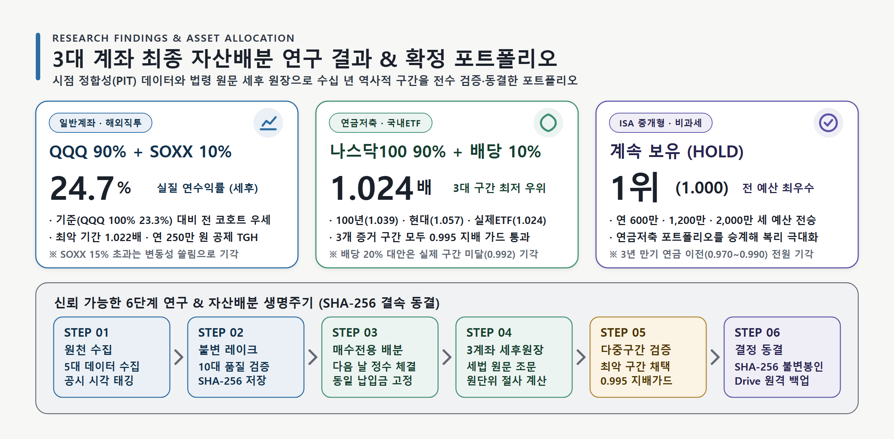
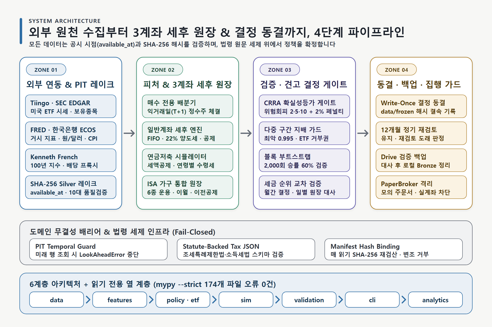
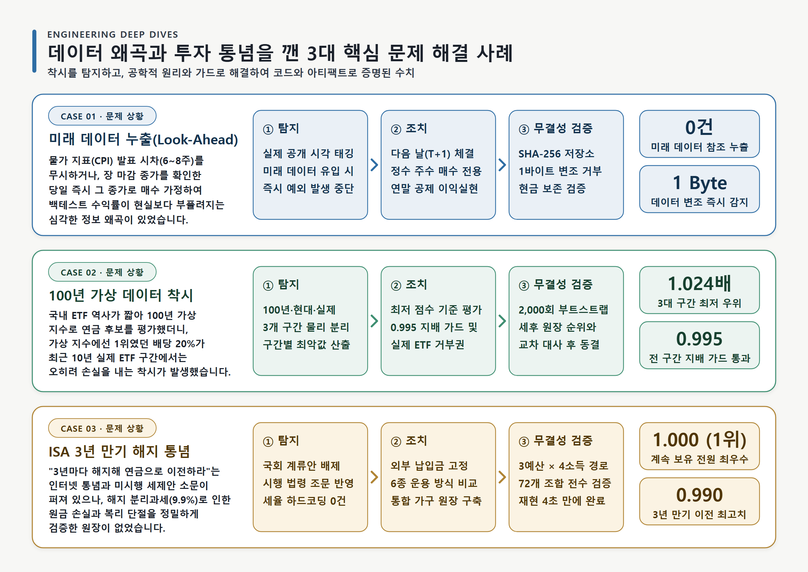

<div align="center">

# ETF-Manager

**미래 정보 누출을 차단한 시점 정합성(PIT) 데이터와 법령 원문 기반 세후 원장으로 검증·동결하는 3계좌 ETF 자산배분 엔진**  
공시 시점(`available_at`) 물리 분리 · 익거래일($t+1$) 매수 체결 & 연말 공제 매도(TGH) · 일반·연금저축·ISA 통합 세후 원장 · 다중 구간 지배 가드 채택 & SHA-256 결정 동결

[](./pyproject.toml) [](./src/data/) [](./src/data/storage.py) [](./configs/tax/) [](./pyproject.toml) [](./tests/)

</div>

<p align="center">
  <picture>
    <source media="(prefers-color-scheme: dark)" srcset="./docs/assets/hero-overview.dark.svg">
    <source media="(prefers-color-scheme: light)" srcset="./docs/assets/hero-overview.light.svg">
    
  </picture>
</p>

---

## 1. 3대 계좌 최종 자산배분 연구 결과 (Research Results)

수십 년의 역사적 데이터와 법령 원문 세후 원장을 시뮬레이션하여 최종 동결된 계좌별 최적 포트폴리오입니다.

| 계좌 구분 | 최종 채택 포트폴리오 | 실측 성과 (기준 = `1.000`) | 기각된 대안 & 공학적 근거 | 결과 정본 |
| :--- | :--- | :---: | :--- | :---: |
| **일반계좌**<br>(해외 직투 · 월 100만 원) | **QQQ 90% + SOXX 10%**<br>(매수 전용 적립 + 연말 공제 TGH) | 실질 연수익률 **`24.7%`**<br>(최악 코호트 **`1.022배`**) | 기준(QQQ 100% `23.3%`) 대비 전 구간 우세. SOXX 15% 초과는 반도체 쏠림 리스크로 기각. | [general.md](./docs/results/general.md) |
| **연금저축**<br>(국내 ETF · 연 600만 원) | **나스닥100 90% + 배당 10%**<br>(국내 상장 ETF 계속 보유) | **3대 구간 100% 가드 통과**<br>(100년 `1.039` · 현대 `1.057` · 실제 `1.024`) | 초기 캠페인(v1/v2)의 QQQ+SOXX 및 배당 20% 대안은 100년 프록시 착시·실제 ETF 미달(`0.992`)로 기각. | [pension.md](./docs/results/pension.md) |
| **ISA 중개형**<br>(비과세 · 연 600만~2천만) | **계속 보유 (`hold`)**<br>(연금저축 인컴번트 종목 공유) | **전 예산 구간 `1.000` (1위)**<br>(3년 만기 연금 이전 최고 `0.990`) | 3년 만기 해지 후 연금 이전 시 추가 세액공제보다 해지 분리과세(9.9%) 원금 손실이 커 전원 기각. | [isa.md](./docs/results/isa.md) |

> **시스템 공통 기본 운용값 & 연구 계보:**  
> 시스템 기본 엔진([targets.py](./src/policy/targets.py))은 **`QQQ 90% + SOXX 10%`**(`OPERATIONAL_TARGETS_OVERRIDE`)로 동결되어 포워드 시뮬레이션 기준선으로 작동합니다. 연금/ISA 적격 국내 상장 ETF 유니버스([pension_etfs_2026.json](./configs/data/pension_etfs_2026.json)) 역시 S&P500(`379800`), 나스닥100(`379810`), RISE 미국반도체NYSE(`469060` = SOXX) 3종을 정준 프록시로 관리합니다.

---

## 2. 핵심 엔지니어링 보장 지표

| 핵심 지표 | 실측 보장 수치 | 아키텍처 메커니즘 & 주요 모듈 |
| :--- | :---: | :--- |
| **일반계좌 세후 실질 수익률** | **`24.7%`** (최악 **`1.022배`**) | 매수 전용 적립 + 익거래일($t+1$) 체결 + 연말 공제 이익실현(TGH) · [after_tax_engine.py](./src/sim/after_tax_engine.py), [general.md](./docs/results/general.md) |
| **연금저축 다중 구간 우위** | **`1.024배`** (3구간 최저) | 100년(`1.039`)·현대(`1.057`)·실제ETF(`1.024`) 최악 점수 & `0.995` 지배 가드 · [pension_decision.py](./src/validation/pension_decision.py), [pension.md](./docs/results/pension.md) |
| **ISA 가구 세후 원장 판정** | **`3/3 예산`** (`hold` 1위) | 운용 방식 6종 × 소득 경로 4종(72조합) 가구 원장 비교, 연금 이전 최고 `0.990` · [isa_household.py](./src/sim/isa_household.py), [isa.md](./docs/results/isa.md) |
| **시계열 정합성 (미래 참조)** | **`0건`** (`Fail-Closed`) | 전 행 `available_at` 부여(3규칙), 미래 데이터 유입 시 `LookAheadError` 중단 · [pit.py](./src/data/pit.py), [pit_market.py](./src/features/pit_market.py) |
| **데이터 무결성 (변조 감지)** | **`1 Byte`** (`SHA-256`) | 정준 프레임 해시·매니페스트 대사, 불일치 시 `UntrustedDatasetError` 거부 · [storage.py](./src/data/storage.py), [quality.py](./src/data/quality.py) |
| **세법 정합성 & 코드 품질** | **`하드코딩 0` / `1,804 Tests`** | 조문 원문 [세법 JSON 3종](./configs/tax/) 키 검증 및 `mypy --strict` 174개 파일 오류 0건 · [tax.py](./src/sim/tax.py), [isa_tax.py](./src/sim/isa_tax.py) |

---

## 3. 시스템 아키텍처 & 생명주기

<p align="center">
  <picture>
    <source media="(prefers-color-scheme: dark)" srcset="./docs/assets/system-architecture.dark.svg">
    <source media="(prefers-color-scheme: light)" srcset="./docs/assets/system-architecture.light.svg">
    
  </picture>
</p>

* **ZONE 01 · 외부 연동 & PIT 불변 레이크:** Tiingo(미국 주가), FRED·한국은행 ECOS(환율·CPI), Kenneth French(100년 지수), SEC EDGAR(보유종목) 5개 원천을 수집([fetch.py](./src/data/fetch.py))하고, 공시 시점 태깅([pit.py](./src/data/pit.py))과 10대 품질 게이트([quality.py](./src/data/quality.py))를 통과한 데이터만 SHA-256 이름의 불변 Silver Parquet([storage.py](./src/data/storage.py))으로 저장합니다.
* **ZONE 02 · 시점 안전 피처 & 3계좌 세후 원장:** 의사결정 시점 $t$ 이전 공개 행만으로 피처([pit_market.py](./src/features/pit_market.py))와 목표 비중([targets.py](./src/policy/targets.py))을 산출합니다. 매수 전용 배분기([allocation.py](./src/sim/allocation.py))와 계좌별 세후 엔진이 일반계좌 FIFO 양도세·TGH([after_tax_engine.py](./src/sim/after_tax_engine.py)), 연금저축 세액공제·수령세([pension_engine.py](./src/sim/pension_engine.py)), ISA 6종 운용 가구 원장([isa_household.py](./src/sim/isa_household.py))을 시뮬레이션합니다.
* **ZONE 03 · 다중 구간 검증 & 견고 결정 게이트:** 단일 백테스트 대신 위험회피 확실성 등가 게이트([gate.py](./src/validation/gate.py)), 3개 증거 구간(100년·현대·실제 ETF) 최악 점수 및 `0.995` 지배 가드([pension_decision.py](./src/validation/pension_decision.py)), 2,000회 블록 부트스트랩([bootstrap.py](./src/validation/bootstrap.py)), 세금 순위 교차 검증을 수행합니다.
* **ZONE 04 · 결정 동결 · 원격 백업 · 모의 집행 가드:** 모든 게이트를 통과한 결정만 `SHA-256(설정 + 커밋 + 매니페스트 + 시드)` 해시와 함께 `data/frozen/`에 Write-Once로 봉인([result_store.py](./src/data/result_store.py))하고 12개월 주기로 재검토합니다. Google Drive 바이트 대사 후 로컬 원본을 정리([backup.py](./tools/devops/backup.py))하며, 모의 브로커([broker.py](./src/execution/broker.py))로 실계좌 주문을 차단합니다.

---

## 4. 핵심 문제 해결 사례 (Engineering Deep Dives)

<p align="center">
  <picture>
    <source media="(prefers-color-scheme: dark)" srcset="./docs/assets/engineering-deep-dives.dark.svg">
    <source media="(prefers-color-scheme: light)" srcset="./docs/assets/engineering-deep-dives.light.svg">
    
  </picture>
</p>

### Case 01. 지표 발표 시차와 당일 체결로 생기는 백테스트 수익률 거품 차단

* **문제 상황:** 물가 지표(CPI)는 발표까지 6~8주 시차가 있는데 이를 관측월 기준으로 조회하거나, 장 마감 종가($t$)를 확인한 당일 즉시 그 종가로 매수했다고 가정하면 백테스트 수익률이 현실보다 크게 부풀려집니다. 원본 파일이 1바이트라도 수정되면 과거 결과를 재현할 수도 없습니다.
* **해결 방법:** ① **탐지:** 모든 데이터에 실제 공개 시각(`available_at`)을 강제하고, 미래 데이터가 유입되면 즉시 실행을 중단([pit.py](./src/data/pit.py))시켰습니다. ② **조치:** 주문은 항상 다음 거래일($t+1$) 종가로 정수 주수만 매수([allocation.py](./src/sim/allocation.py))하고, 연말 250만 원 공제 한도 내 이익실현만 허용했습니다. ③ **무결성 검증:** 저장소 파티션을 해시로 봉인하여 매 읽기 시 1바이트 변조도 즉시 감지([storage.py](./src/data/storage.py))하도록 구현했습니다.
* **검증된 성과:** 미래 정보 참조 **`0건`**, 데이터 변조 감지 **`1 Byte`**, 일반계좌(QQQ 90% + SOXX 10%) 세후 실질 연수익률 **`24.7%`** (기준 QQQ 100% `23.3%`, 최악 코호트 **`1.022배`**)를 달성했습니다 ([general.md](./docs/results/general.md)).

### Case 02. 100년 가상 데이터가 만드는 착시 차단 (지배 가드 & 실제 ETF 거부권)

* **문제 상황:** 국내 ETF의 짧은 역사를 보완하기 위해 100년 가상 지수로 연금저축 후보를 평가했더니, 100년 가상 구간에서는 1위였던 배당 20% 조합(`schd20_qqq80`)이 최근 10년 실제 상장 ETF 구간에서는 기준선 대비 오히려 손실(`0.992`)을 내는 데이터 착시가 발생했습니다.
* **해결 방법:** ① **탐지:** 증거 구간을 `100년 지수(1927~)`·`현대(1999~)`·`실제 ETF` 3개로 물리 분리([pension_decision.py](./src/validation/pension_decision.py))했습니다. ② **조치:** 모든 구간의 **최저 점수**를 기준으로 평가하고, 기준 조합 대비 단 한 칸이라도 `0.995` 미만이거나 실제 ETF 구간에서 뒤처지면 즉시 탈락시키는 거부권을 도입했습니다. ③ **무결성 검증:** 2,000회 블록 부트스트랩(승률 60% 이상)과 일별 세후 원장 캠페인([pension_campaign.py](./src/validation/pension_campaign.py)) 순위를 교차 검증했습니다.
* **검증된 성과:** 가상 착시 종목을 전수 탈락시키고, 3개 구간 모두 우위(100년 **`1.039`**, 현대 **`1.057`**, 실제 ETF **`1.024`**)를 기록한 **나스닥100 90% + 배당 10%(`schd10_qqq90`)**를 최종 채택·동결했습니다 ([pension.md](./docs/results/pension.md)).

### Case 03. "ISA 3년 만기마다 연금으로 넘겨라"는 인터넷 재테크 통념 검증

* **문제 상황:** 시중에는 국회 계류 중인 미시행 세법 소문이 퍼져 있었고, "3년 만기마다 ISA를 해지해 연금으로 넘겨야 세액공제로 이득"이라는 통념 역시 해지 시 발생하는 세금 누수(9.9%)와 복리 단절을 정밀하게 계산해 보지 않은 한계가 있었습니다.
* **해결 방법:** ① **탐지:** 법제처 시행 조문만 [kr_isa_2026.json](./configs/tax/kr_isa_2026.json)에 선언하고 스키마 불일치 시 실행을 거부([isa_tax.py](./src/sim/isa_tax.py))했습니다. ② **조치:** 모든 운용 방식에서 외부 납입 총액을 동일하게 고정한 통합 가구 세후 원장([isa_household.py](./src/sim/isa_household.py))을 구축하고 6종 운용 방식을 비교했습니다. ③ **무결성 검증:** 예산 3종(연 600만·1,200만·2,000만 원) × 소득 경로 4종(총 72개 조합)을 전수 시뮬레이션했습니다.
* **검증된 성과:** 추가 세액공제(연 최대 30만~45만 원)보다 해지 분리과세(9.9%) 원금 손실이 더 큼을 입증하여, **3개 예산 모두 계속 보유(`hold`, `1.000`)가 1위**임을 확정(3년 만기 연금 이전 최고 **`0.990`**으로 탈락)하고 약 **`4초`** 만에 전 조합 재현을 완료했습니다 ([isa.md](./docs/results/isa.md)).

---

## 5. 기술 스택 & 계층 구조

| 분류 | 기술 스택 | 채택 근거 및 엔지니어링 활용 |
| :--- | :--- | :--- |
| **Language & Typing** | **Python 3.11**, **`uv`**, **`mypy --strict`**, **Ruff** | 결정론적 의존성 잠금(`uv.lock`), 174개 소스 파일 `mypy --strict` 오류 0건 및 정적 린트 강제 |
| **Data Engine & Storage** | **Polars 1.43**, **PyArrow**, **Parquet**, **SHA-256** | 외부 DB 데몬 없이 수십 년 시계열 고속 컬럼 연산 및 SHA-256 내용 주소화 불변 레이크 |
| **Simulation & Numerics** | **NumPy**, **Tax Lot Book**, **Decimal** | 롤링 코호트·부트스트랩 벡터 연산, 일반계좌 로트별 양도세 및 법령 세액 원 단위 절사 계산 |
| **Domain & Market** | **`exchange-calendars`**, **Pydantic 2**, **httpx** | 미국·한국 영업일 분리 동기화, 5대 외부 벤더(Tiingo·FRED·ECOS·French·SEC) 수집 및 스키마 검증 |
| **Verification & Ops** | **pytest (1,804 Tests)**, **Hypothesis**, **`rclone`** | 현금 보존·비중 합(`1.0`)·가구 납입금 항등식 속성 기반 검증 및 Google Drive 바이트 대사 백업 |

### 디렉터리 및 6-Layer 아키텍처 구조

단방향 계층 분리를 따르며, 진단(`analytics`)과 모의 집행(`execution`)은 결정 경로에 개입하지 않는 읽기 전용 옆 계층으로 격리되어 있습니다.

```text
ETF-Manager/
├── src/
│   ├── data/          # [Layer 1] 5대 벤더 수집(fetch), PIT 태깅(pit), 10대 품질 게이트(quality), SHA-256 저장소(storage)
│   ├── features/      # [Layer 2] 공시 시점 안전 피처(pit_market), 수익률·변동성·낙폭·팩터 계산
│   ├── policy/        # [Layer 3] 목표 비중(targets), 세후 규칙 파서, 잦은 교체 방지 완충 및 예비금(reserve)
│   ├── etf/           # [Layer 3] 자산군 슬리브 정의(sleeves), 국내·미국 상장 ETF 매핑(mapping) 및 점수화
│   ├── sim/           # [Layer 4] 매수 전용 배분(allocation), 일반계좌 세후 원장(after_tax_engine), 연금(pension_*), ISA 가구(isa_*)
│   ├── validation/    # [Layer 5] 확실성 등가 게이트(gate), 롤링 코호트, 부트스트랩, 연금·ISA 견고 결정 및 동결 기록
│   ├── cli_commands/  # [Layer 6] CLI 명령 라우터 (ingest, sim_run, campaign, campaign_pension, thesis, maintenance)
│   ├── analytics/     # [Sidecar] 투자 가설 5대 관점 진단 및 귀속 분석 (읽기 전용, 결정 경로 미개입)
│   └── execution/     # [Sidecar] 매수 주문서 생성(orders) 및 모의 브로커(PaperBroker, 실계좌 주문 차단)
├── configs/
│   ├── tax/           # 조세특례제한법·소득세법 조문 원문 기반 세법 설정 3종 (kr_overseas_equity, kr_pension_2026, kr_isa_2026)
│   ├── decision/      # 3계좌 최종 결정 설정 정본 (general.json, pension.json, isa.json)
│   └── research/      # 캠페인 실험 명세 및 누적 시험 이력 색인 (INDEX.json)
├── docs/
│   ├── results/       # 3계좌 채택 결론 및 64자 SHA-256 동결 아티팩트 해시 정본 (general.md, pension.md, isa.md)
│   └── assets/        # 다크/라이트 테마 대응 고해상도 아키텍처·트러블슈팅 인포그래픽 (SVG & 2x PNG)
├── tests/             # 1,804개 단위·속성 기반(Hypothesis)·문서 정합성 테스트 스위트
└── tools/             # 통합 품질 게이트(verify.py) 및 Google Drive 검증 백업(devops/backup.py)
```

---

## 6. 빠른 시작 및 검증

```bash
# 1. 가상환경 동기화 및 정규화 데이터 복원 (데이터 없이도 전체 테스트는 즉시 통과)
uv sync --all-groups
uv run python tools/devops/backup.py pull

# 2. 단위·속성 기반 테스트(1,804건), 정적 타입 검사(mypy --strict), 통합 품질 게이트 실행
uv run pytest && uv run ruff check . && uv run mypy src
uv run python tools/verify.py

# 3. 3계좌 최종 자산배분 결정 및 역사적 검증 캠페인 재현 (--freeze 시 data/frozen/에 불변 봉인)
uv run python -m src.cli run final-historical-campaign --config configs/decision/general.json --seed 42
uv run python -m src.cli run pension-decision --config configs/decision/pension.json --seed 42
uv run python -m src.cli run isa-household --config configs/decision/isa.json --seed 42

# 4. 일반계좌 운영 표준 시뮬레이션 (QQQ 90% + SOXX 10%, 월 100만 원 적립) 및 원격 백업
uv run python -m src.cli run policy --id qqq --start 2016-07-01 --end 2026-06-30 --contribution-krw 1000000
uv run python tools/devops/backup.py push
```
