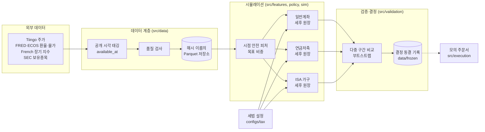

# ETF-Manager

**일반계좌·연금저축·ISA, 세 계좌에 ETF를 적립식으로 담을 때 어떤 구성이 가장 나은지 과거 데이터와 세법으로 시뮬레이션해 결정하는 연구 프로젝트**

[](./pyproject.toml) [](./src/data/) [](./configs/tax/) [](./pyproject.toml)

> [!NOTE]
> 이 README의 수익률 수치는 모두 **과거 데이터 백테스트(시뮬레이션)** 결과이며, 실계좌 수익이 아닙니다. 투자 권유가 아닙니다.
> 원본 데이터(`data/`)는 저장소에 없고 로컬과 Google Drive에만 있습니다. 대신 결과 요약과 근거 해시를 [`docs/results/`](./docs/results/)에 남겼습니다.

## 🧭 개요

같은 ETF라도 어느 계좌에 담느냐에 따라 세금, 납입 한도, 인출 조건이 달라서 "무엇을 살까"의 답도 달라집니다. 이 프로젝트는 계좌마다 따로 후보를 비교하고, 세금까지 반영한 원화 기준 최종 자산이 가장 안정적으로 나은 구성을 고릅니다.

| 계좌 | 납입 가정 | 비교한 것 |
| :--- | :--- | :--- |
| 일반계좌 | 월 100만 원 | 미국 ETF 비중, 매도 규칙 |
| 연금저축 | 연 600만 원 | 국내 상장 ETF 후보 조합 |
| ISA 중개형 | 연 600만·1,200만·2,000만 원 | 계속 보유할지, 연금으로 옮길지 등 6가지 운용 방식 |

핵심은 **백테스트 착시를 줄이는 것**입니다. 발표 전 데이터를 쓰지 않고, 신호를 본 당일 종가로 사지 않고, 한 구간에서만 좋은 결과는 채택하지 않도록 했습니다.

## 🏗️ 시스템 구성

배치로 돌리는 연구 도구입니다(서버가 아닙니다). 수집부터 결정 기록 보관까지 한 방향으로 흐릅니다.



- 위 계층이 아래 계층만 참조하도록 나눴습니다(데이터 → 피처 → 정책 → 시뮬레이션 → 검증 → CLI). 다만 이 방향은 자동 테스트로 강제하지 않습니다([설계 문서](./docs/architecture/system-design.md)).
- 투자 가설 진단(`src/analytics`)과 모의 주문(`src/execution`)은 결정 경로에 관여하지 않는 옆 계층입니다. 실계좌 주문 연동은 없습니다.
- 세법 값은 코드에 직접 쓰지 않고 [`configs/tax/`](./configs/tax/)의 JSON 3종(해외 ETF, 연금저축, ISA)에서 읽습니다. 키가 정확히 일치하지 않으면 실행을 멈춥니다.

## 🔧 핵심 설계 결정

각 결정을 **문제 → 분석(대안 비교) → 선택 → 결과** 순서로 정리했습니다. 전체 목록은 [`engineering-decisions.md`](./docs/architecture/engineering-decisions.md)에 있습니다.

### 🕐 1. 미래 정보를 쓰지 않도록 시점을 강제한 이유

- **문제:** 물가 지표는 해당 월이 끝나고 6~8주 뒤에 발표됩니다. 관측 월로 조회하거나, 종가를 본 뒤 같은 종가로 샀다고 가정하면 백테스트가 현실보다 좋게 나옵니다.
- **분석:** 관측일 기준 정렬은 단순하지만 미래 누출을 막지 못합니다. 그래서 모든 행에 실제 공개 시각(`available_at`)을 붙이기로 했습니다. 미국 종가는 한국 새벽에 확정되므로 같은 종가 체결도 현실적이지 않습니다.
- **선택:** 의사결정 시점 이후에 공개된 행이 조회되면 `LookAheadError`로 중단합니다([`pit.py`](./src/data/pit.py)). 주문은 다음 거래일 종가에 정수 주수로 체결합니다([`allocation.py`](./src/sim/allocation.py)). 성과는 한국 CPI로 물가를 반영한 실질 원화로 평가합니다.
- ✅ **결과:** 미래 데이터가 섞이면 실행이 멈춥니다. 다음 거래일 체결로 생기는 1일 지연은 비용으로 받아들였습니다.

### 🔒 2. 데이터를 바꿀 수 없게 저장한 이유

- **문제:** 데이터가 조금만 달라져도 과거 결과를 재현할 수 없습니다.
- **분석:** SQLite 같은 DB는 행을 수정할 수 있어 변경 추적이 어렵습니다. DB 서버 없이 쓰려고 파일 기반으로 정했습니다.
- **선택:** 정규화한 데이터를 내용 SHA-256을 이름으로 하는 Parquet 파일과 매니페스트로 저장하고, 읽을 때마다 해시를 다시 계산합니다. 불일치하면 `UntrustedDatasetError`로 읽기를 거부합니다([`storage.py`](./src/data/storage.py)). 결과에는 사용한 데이터의 해시를 함께 기록합니다.
- ✅ **결과:** 결과를 특정 설정·커밋·데이터와 연결할 수 있습니다. 대신 행 단위 수정이 안 되어 파티션을 새로 써야 합니다.

### 💸 3. 일반계좌는 매수 전용 적립에 연말 이익실현만 허용한 이유

- **문제:** 해외 ETF 매도 차익에는 양도세 22%가 붙습니다(연 250만 원 공제). 한편 공제는 쓰지 않으면 사라집니다.
- **분석:** 정기 리밸런싱이나 위험 회피 매도는 세금을 바로 만듭니다. 설계 문서에 따르면 위험 회피 매도와 자산 순환은 시험한 모든 구간에서 세후 중위 자산이 줄었습니다.
- **선택:** 평소에는 팔지 않고 새 납입금만 목표 비중에 모자란 종목에 배분합니다. 매년 12월에 250만 원 공제 한도 안에서만 이익을 실현하고 같은 날 재매수합니다([`after_tax_engine.py`](./src/sim/after_tax_engine.py)).
- ✅ **결과:** 설계 문서 기준(백테스트), 매수 전용 대비 세후 청산 자산이 10년 코호트 16개 중위 +1.4%(최악 +0.4%), 20년 코호트 6개 중위 +0.4%였습니다. 효과는 작은 편입니다.

### 🎯 4. 평균 수익률 대신 위험을 반영한 채택 기준을 쓴 이유

- **문제:** 평균 수익률이나 샤프지수는 가끔 크게 잃는 후보와, 규칙을 덧붙여 과거에만 맞춘 후보를 걸러내지 못합니다.
- **분석:** MDD(최대 낙폭) 하한선은 기준값 선택이 임의적입니다. 대신 손실을 더 크게 반영하는 확실성 등가 수익률(위험회피도를 반영한 평균)을 쓰기로 했습니다.
- **선택:** 위험회피도 3단계(γ=2, 5, 10)에서 모두 기준을 이기고, 규칙·모듈 수에 따라 2%씩 높아지는 문턱을 넘어야 채택합니다([`gate.py`](./src/validation/gate.py)).
- ✅ **결과:** 평균은 높지만 변동이 큰 공격적 후보가 탈락합니다. 이 보수성은 트레이드오프로 받아들였습니다.

### 🧪 5. 연금저축은 세 구간에서 모두 통과한 조합만 채택한 이유

- **문제:** 국내 ETF는 역사가 짧아서 1927년부터의 장기 지수로 보완했는데, 장기 지수에서 높게 나온 조합이 실제 ETF 구간에서는 기준보다 나빴습니다.
- **분석:** 장기 지수 한 구간만 보면 착시에 속습니다. 증거 구간을 장기 지수(1927~), 현대(1999~), 실제 ETF의 세 가지로 나누어 각각 비교했습니다.
- **선택:** 후보 점수를 모든 칸의 최저값으로 정하고, 기준 조합 대비 0.995 미만인 칸이 있거나 실제 ETF 구간이 실패하면 탈락시킵니다. 이후 부트스트랩(2,000회, 승률 0.6 이상)과 세금 포함 전체 원장 순위 일치를 확인하고 결정을 동결합니다([`pension_decision.py`](./src/validation/pension_decision.py)).
- ✅ **결과:** 나스닥100(QQQ) 90% + 미국 배당주 ETF(SCHD) 10%가 세 구간을 모두 통과했고, 비교한 다른 두 후보는 한 구간씩 탈락했습니다(아래 결과 참고).

### 🏦 6. ISA는 "3년마다 연금으로 옮기기"를 가구 전체 자산으로 비교한 이유

- **문제:** "ISA 만기 때마다 해지해 연금으로 넘기면 세액공제로 이득"이라는 말이 흔한데, 해지세와 복리 중단까지 같이 따져 보기 어렵습니다.
- **분석:** ISA 안만 보면 판단이 어긋납니다. 연금저축과 일반계좌까지 합친 가구 전체의 세후 자산을, 모든 방식에서 외부 납입 총액이 같다는 조건으로 비교해야 합니다.
- **선택:** 운용 방식 6종 × 예산 3종 × 소득 경로 4종을 가구 원장([`isa_household.py`](./src/sim/isa_household.py))으로 시뮬레이션했습니다. 세율은 법령 조문 원문으로 확인한 값만 설정에 넣었고, 블로그에서 본 "비과세 한도 확대"는 현행법에 없어서 쓰지 않았습니다.
- ✅ **결과:** 세 예산 모두 계속 보유가 1위였고, 연금 이전 방식은 최고 0.990으로 기준에 못 미쳤습니다.

## 📊 결과

모두 백테스트 결과이며, 아래 표는 [`docs/results/`](./docs/results/)에 적힌 값입니다. 수치는 세후·실질 원화 기준이고, 연금저축과 ISA는 기준 조합을 1.000으로 둔 상대값입니다.

| 계좌 | 채택안 | 핵심 수치 (백테스트) | 결과 문서 |
| :--- | :--- | :--- | :--- |
| 일반계좌 | QQQ 90% + SOXX 10% | 실질 연수익률 24.7%(QQQ 100%는 23.3%), 최악 기간 1.022 | [general.md](./docs/results/general.md) |
| 연금저축 | QQQ 90% + SCHD 10% | 100년 1.039, 현대 1.057, 실제 ETF 1.024 | [pension.md](./docs/results/pension.md) |
| ISA 중개형 | QQQ 90% + SCHD 10% 계속 보유 | 3개 예산 모두 1위(연금 이전 방식은 0.970~0.990) | [isa.md](./docs/results/isa.md) |

- **일반계좌:** 4개 기간 모두에서 QQQ 100%보다 우세했습니다. SOXX 15%는 반도체 쏠림을 이유로 기각했습니다.
- **연금저축:** 기준 조합은 QQQ 80% + SPY(S&P500) 20%입니다. QQQ 80% + SCHD 20%는 100년 1.069, 현대 1.003이었지만 실제 ETF 구간 0.992로 탈락했습니다. QQQ 100%는 현대 1.113이지만 100년 구간 0.995로 탈락했습니다.
- **ISA:** 새 종목을 따로 고르지 않고 연금저축과 같은 QQQ 90% + SCHD 10%를 그대로 씁니다. 3년마다 전액 연금 이전은 0.970(600만 원), 0.977(1,200만 원), 0.990(2,000만 원)이었습니다. 추가 세액공제가 해지세 9.9%를 넘지 못했습니다.
- 결과 문서에는 설정 해시, 데이터 매니페스트 해시, 커밋이 함께 기록되어 있습니다. 연금저축 동결 기록은 2026-08-31자입니다.
- 시스템 기본 운용 비중은 [`targets.py`](./src/policy/targets.py)에 QQQ 90% + SOXX 10%로 고정되어 있습니다.

## ⚠️ 한계

- 한국 CPI 가용 기간(2012-08~)이 실질 원화 비교 구간을 제한하고, 120개월 코호트 4개는 서로 겹칩니다.
- 닷컴 버블·2008 금융위기는 실제 ETF 상장 이전이라 장기 지수 대체 데이터로만 검증합니다. 실제 ETF 구간은 10년 기간이 5개뿐이라 참고용입니다.
- 연금·ISA 결정은 월 단위, 환율 중립 근사입니다. 법정 금액은 물가에 연동하지 않은 명목값입니다.
- 세 결정이 같은 과거 데이터를 공유하므로 독립된 발견이 아니며, 사후 선택 편향이 남아 있습니다. 누적 시험 횟수(39~55회)는 결과 문서에 공개했습니다.
- ISA 3년 미만 중도해지와 2027년 세제개편안(국회 계류)은 모델링하지 않았습니다. 계속 보유 결론은 현행법 전제라 표결 후 재확인이 필요합니다.
- 일반계좌 결과 문서는 실행 id와 시드를 기록하지 않은 이전 실행(legacy 아티팩트)을 근거로 합니다.

## 🧱 기술 스택

| 구분 | 사용 기술 |
| :--- | :--- |
| 언어·도구 | Python 3.11, uv, Ruff, mypy(strict), pytest |
| 데이터 | Polars, PyArrow, Parquet, SHA-256 |
| 검증·설정 | Pydantic 2, pydantic-settings, httpx, tenacity, exchange-calendars |
| 외부 데이터 | Tiingo, FRED, 한국은행 ECOS, Kenneth French, SEC EDGAR |
| 백업 | rclone으로 Google Drive에 미러링([`backup.py`](./tools/devops/backup.py)) |

## 📂 프로젝트 구조

```text
src/
├── data/          # 수집, 공개 시각 태깅, 품질 검사, 해시 저장소
├── features/      # 시점 안전 피처(수익률, 변동성, 낙폭 등)
├── policy/        # 목표 비중, 세후 규칙, 예비금
├── etf/           # ETF 매핑과 점수화
├── sim/           # 일반계좌·연금저축·ISA 세후 원장
├── validation/    # 확실성 등가 게이트, 코호트, 부트스트랩, 결정·동결
├── cli_commands/  # 명령행 진입점(ingest, run, campaign 등)
├── analytics/     # 투자 가설 진단(읽기 전용)
└── execution/     # 매수 주문서, 모의 브로커
configs/
├── tax/           # 법령 기반 세법 설정 3종
├── decision/      # 계좌별 최종 결정 설정(general, pension, isa)
└── research/      # 실험 명세와 시험 이력 색인
docs/
├── results/       # 계좌별 결과와 근거 해시
└── architecture/  # 설계 문서, 설계 결정 기록
tests/             # 단위 테스트
tools/             # 품질 검사(verify.py), Drive 백업(devops/backup.py)
```

## 🚀 시작하기

데이터 수집에는 각 제공처의 API 키가 필요하며 저장소에 포함되어 있지 않습니다. 데이터 없이 테스트만 돌릴 수 있게 구성했습니다. 아래 결정 재현 명령은 데이터를 갖춘 뒤에 실행합니다.

```bash
uv sync --all-groups

# 테스트, 정적 검사, 통합 품질 검사
uv run pytest && uv run ruff check . && uv run mypy src
uv run python tools/verify.py

# 계좌별 결정 재현 (데이터가 있어야 합니다)
uv run python -m src.cli run final-historical-campaign --config configs/decision/general.json --seed 42
uv run python -m src.cli run pension-decision --config configs/decision/pension.json --seed 42
uv run python -m src.cli run isa-household --config configs/decision/isa.json --seed 42
```

## 🤖 개발 과정에서의 AI 활용

AI는 주로 코드 작성에 사용했고, 아이디어 정리와 도메인(세법, 투자 개념) 학습에도 활용했습니다. **결과 수치와 동작은 직접 확인했습니다.** 저장소에는 AI 코딩 도구용 지침 파일([`AGENTS.md`](./AGENTS.md))이 있습니다.

## 📚 참고

- [시스템 설계 문서](./docs/architecture/system-design.md)
- [설계 결정 기록](./docs/architecture/engineering-decisions.md)
- [계좌별 결과 문서](./docs/results/README.md)
